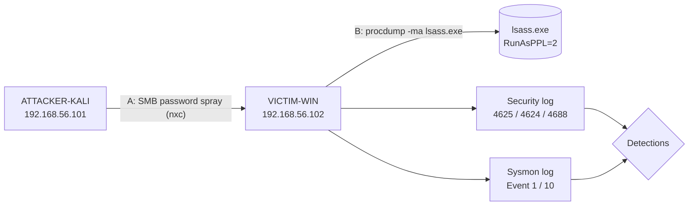

# SOC Lab 1: Detecting Password Spraying and LSASS Credential Dumping

A home purple-team lab: run two common attacker techniques against an isolated Windows host and detect them using native Windows logging and Sysmon.

## Lab Environment

| Host | Role | IP |
|---|---|---|
| ATTACKER-KALI | Attacker (NetExec, ProcDump) | 192.168.56.101 |
| VICTIM-WIN (DESKTOP-0TMT1TC) | Target, Windows 10/11 | 192.168.56.102 |

- VirtualBox host-only network (isolated, no internet)
- Telemetry: Sysmon v15.22, Security log with process creation and command-line auditing (4688), PowerShell Script Block Logging (4104)



## Attack A: SMB Password Spray (MITRE ATT&CK T1110.003)

**Execution (Kali):**
```bash
nxc smb 192.168.56.102 -u users.txt -p 'Hacking101'
```

**Detection:** Event 4625 (failed logon) from the attacker's IP, followed by a 4624 success.
```powershell
Get-WinEvent -FilterHashtable @{LogName='Security'; Id=4625} |
  Where-Object { $_.Message -match '192.168.56.101' } |
  Format-List TimeCreated, Message
```

**Result:** Detected. Failed network logons from 192.168.56.101 were recorded. The 4625 logged the account name as `users.txt` because of a tool input mistake, but the source IP and failure pattern are the indicator.

## Attack B: LSASS Credential Dumping (MITRE ATT&CK T1003.001)

**Attempt 1:** `rundll32 comsvcs.dll, MiniDump` against LSASS
- Blocked by AMSI/Defender ("This script contains malicious content"). Real-time protection was disabled for the lab.
- No dump file was created because LSASS runs as a Protected Process Light (`RunAsPPL = 2`, locked by UEFI Secure Boot).

**Attempt 2:** Sysinternals ProcDump
```powershell
C:\Windows\Temp\procdump64.exe -accepteula -ma lsass.exe C:\Windows\Temp\lsass.dmp
# Error opening lsass.exe (828): Access is denied. (0x00000005)
```

### Detection Engineering Journey

| Data source | Result | Why |
|---|---|---|
| Sysmon Event 10 (ProcessAccess) | Nothing logged | Sysmon was first running **with no config loaded**. Once a rule for TargetImage `lsass.exe` was added, the kernel still denied the PPL handle before Sysmon's callback logged it. |
| Security Event 4656 (handle request, Kernel Object auditing) | Nothing logged | The protected-process check rejects the request before the object access audit runs. |
| **Security Event 4688 (process creation + command line)** | **Detected** | Logged every attempt, including who ran it, the elevated token and the full command line. |

**Detection query:**
```powershell
Get-WinEvent -FilterHashtable @{LogName='Security'; Id=4688} |
  Where-Object { $_.Message -match 'procdump' -and $_.Message -match 'lsass' } |
  Format-List TimeCreated, Message
```

**Evidence (summary of 3 events, 11/3/2026):**
```
Account Name:          soclab1
New Process Name:      C:\Windows\Temp\procdump64.exe
Token Elevation Type:  TokenElevationTypeFull (2)
Creator Process Name:  C:\Windows\System32\WindowsPowerShell\v1.0\powershell.exe
Process Command Line:  "C:\Windows\Temp\procdump64.exe" -accepteula -ma lsass.exe C:\Windows\Temp\lsass.dmp
```

## Key Findings

1. **Detect the attempt, not just the success.** PPL stopped the dump, but an elevated user running `procdump -ma lsass` still needs investigating. Attackers who fail will try other tools.
2. **Check your sensor config.** Sysmon was installed but had no rule groups loaded, so it recorded almost nothing. Always check with `Sysmon64.exe -c`.
3. **Some defenses also hide telemetry.** PPL blocks the handle before handle-based logging (Sysmon Event 10, 4656) can record it. Process creation with command-line logging covered that gap.
4. **Layered defenses worked.** AMSI caught the comsvcs one-liner, and PPL stopped ProcDump.

## Recommended Alerts

| Alert | Logic |
|---|---|
| Password spray | ≥ N Event 4625 from one source IP across accounts in a short window, especially followed by a 4624 |
| LSASS dump tooling | Event 4688 / Sysmon 1 where the command line contains `lsass` with `-ma`, `MiniDump` or `comsvcs` |
| LSASS access (where PPL is off) | Sysmon 10 where TargetImage is lsass.exe from a non-system SourceImage |

## Files

- [`detections/sysmon-lsass-config.xml`](detections/sysmon-lsass-config.xml): minimal Sysmon config used
- [`detections/hunt-queries.ps1`](detections/hunt-queries.ps1): all hunt queries

## Cleanup

```powershell
Set-MpPreference -DisableRealtimeMonitoring $false
Remove-Item C:\Windows\Temp\procdump64.exe
```
