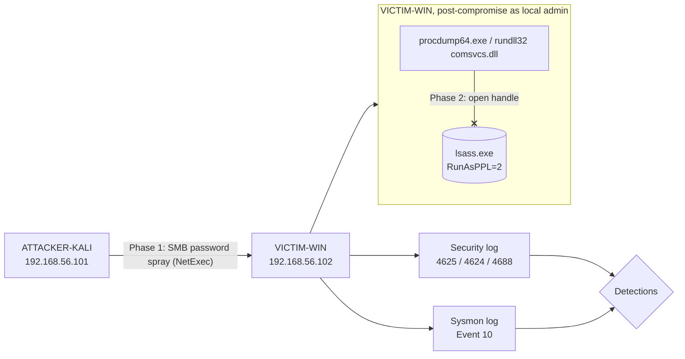
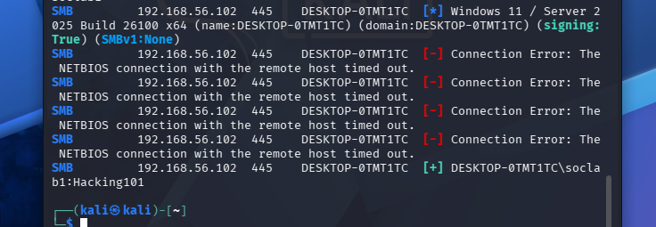
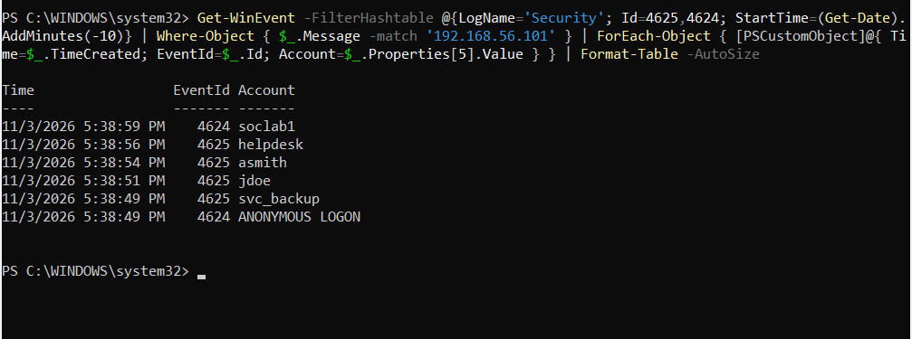
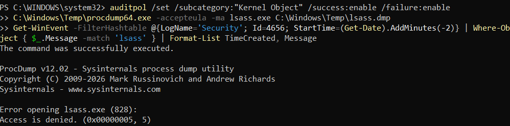
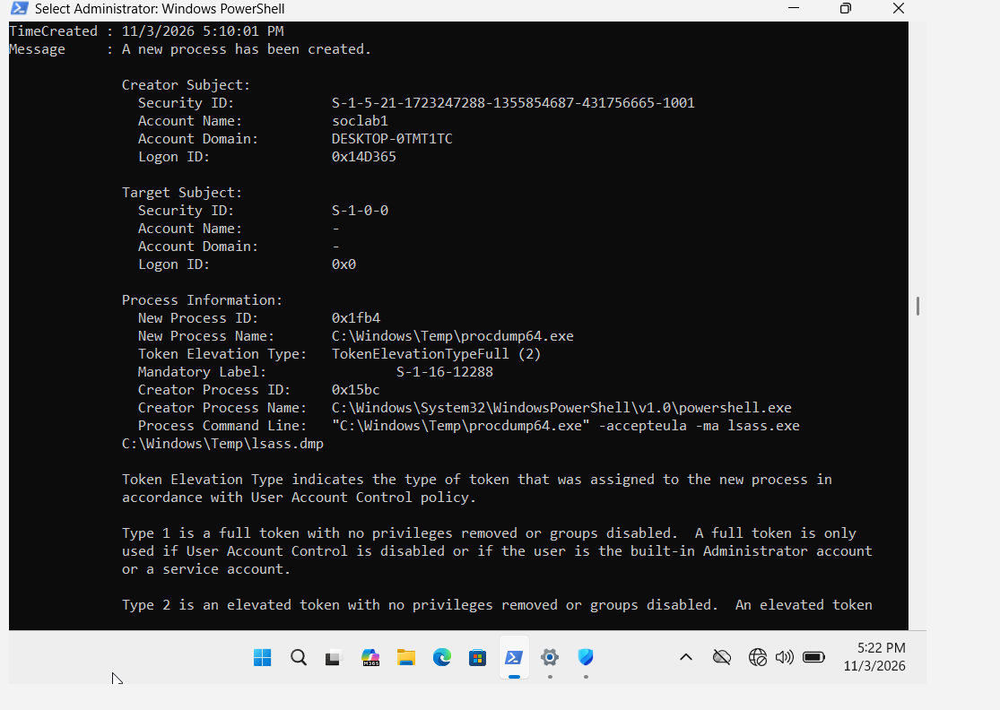

# SOC Lab 1: Detecting Password Spraying and LSASS Credential Dumping

## TL;DR

- **What:** Simulated two common credential-access techniques against an isolated Windows host: an SMB password spray (T1110.003) and LSASS memory dumping (T1003.001).
- **Detected by:** Security Events 4625/4624 (spray) and Event 4688 with command-line auditing (LSASS dump attempts).
- **Key finding:** With LSASS running as a Protected Process Light (PPL), dump attempts were blocked, and handle-based telemetry (Sysmon Event 10, Security 4656) recorded nothing. Process-creation logging with the command line was the only source that captured the attempts.

## Scenario and Scope

An attacker on the same network sprays a common password against local accounts on a Windows workstation. With a valid local administrator account, the attacker then attempts to dump LSASS memory to collect credentials (post-compromise activity on the host).

## Lab Environment

| Host | Role | IP |
|---|---|---|
| ATTACKER-KALI | Network attacker (NetExec) | 192.168.56.101 |
| VICTIM-WIN (DESKTOP-0TMT1TC) | Target, Windows 11 Enterprise Evaluation 10.0.26200 (build 26200) | 192.168.56.102 |

- VirtualBox host-only network, isolated with no internet access
- Telemetry: Sysmon v15.22 (minimal config, see [`detections/sysmon-lsass-config.xml`](detections/sysmon-lsass-config.xml)), Security log process creation with command-line auditing (4688), PowerShell Script Block Logging (4104)
- All accounts and passwords in this repo (e.g. `soclab1` / `Hacking101`) are throwaway lab credentials that exist only in this isolated environment.



## Attack A: SMB Password Spray (MITRE ATT&CK T1110.003)

**Execution (Kali):** one password tried against five usernames. Three are real accounts with a different password (`svc_backup`, `jdoe`, `asmith`), one doesn't exist (`helpdesk`, intentionally not created) and one uses the sprayed password (`soclab1`).
```bash
printf "svc_backup\njdoe\nasmith\nhelpdesk\nsoclab1\n" > users.txt
nxc smb 192.168.56.102 -u users.txt -p 'Hacking101' --continue-on-success
```



NetExec reported the four failed attempts as NetBIOS connection errors rather than `STATUS_LOGON_FAILURE`. The Windows Security log confirms they were real authentication failures (below), which is why the target's logs, not the attacker tool's output, count as the evidence.

**Detection:** a burst of Event 4625 (failed logon, Logon Type 3) for several different accounts from one source IP, followed by an Event 4624 success. One source, many accounts and one password at a time is the signature of a spray. A brute-force attack looks different: many passwords against a single account.

```powershell
Get-WinEvent -FilterHashtable @{LogName='Security'; Id=4625,4624; StartTime=(Get-Date).AddMinutes(-10)} |
  Where-Object { $_.Message -match '192.168.56.101' } |
  ForEach-Object { [PSCustomObject]@{ Time=$_.TimeCreated; EventId=$_.Id; Account=$_.Properties[5].Value } } |
  Format-Table -AutoSize
```



**Result:** Detected. Within 10 seconds (5:38:49 to 5:38:59 PM local VM time), the Security log recorded four 4625 failures for different accounts from 192.168.56.101, then a 4624 success for `soclab1`. That is the full spray pattern: one source, many accounts, one compromise. The `ANONYMOUS LOGON` 4624 is SMB's normal null-session handshake, not a compromised account.

**Alert-style query:** flags any source IP with failed logons against 3 or more distinct accounts within 10 minutes, without hard-coding the attacker's IP.
```powershell
Get-WinEvent -FilterHashtable @{LogName='Security'; Id=4625; StartTime=(Get-Date).AddMinutes(-10)} |
  ForEach-Object { [PSCustomObject]@{ Src=$_.Properties[19].Value; User=$_.Properties[5].Value } } |
  Group-Object Src |
  Where-Object { ($_.Group.User | Sort-Object -Unique).Count -ge 3 } |
  Select-Object @{n='SourceIP';e={$_.Name}}, @{n='Failures';e={$_.Count}}, @{n='DistinctAccounts';e={($_.Group.User | Sort-Object -Unique).Count}}
```

Sigma rule: [`detections/sigma/password-spray-smb.yml`](detections/sigma/password-spray-smb.yml)

## Attack B: LSASS Credential Dumping (MITRE ATT&CK T1003.001)

Run locally on VICTIM-WIN as `soclab1` from an elevated PowerShell, simulating an attacker who already has local admin.

**Attempt 1:** `rundll32.exe comsvcs.dll, MiniDump` against LSASS
- Blocked at first by AMSI/Defender ("This script contains malicious content"). Real-time protection was then disabled for the lab (see Limitations).
- Still produced no dump file. LSASS runs as a Protected Process Light (`RunAsPPL = 2`, which is enforced through UEFI Secure Boot).

**Attempt 2:** Sysinternals ProcDump
```powershell
C:\Windows\Temp\procdump64.exe -accepteula -ma lsass.exe C:\Windows\Temp\lsass.dmp
# Error opening lsass.exe (828): Access is denied. (0x00000005)
```



### Which telemetry captured the attempt?

| Data source | Observed result | Likely cause (not independently verified) |
|---|---|---|
| Sysmon Event 10 (ProcessAccess) | No event for procdump or rundll32 targeting lsass | At first, Sysmon was running with **no config loaded**. After a TargetImage `lsass.exe` include rule was loaded (confirmed with `Sysmon64.exe -c`), the denied PPL handle requests still produced no event. The likely cause is that the request is rejected before Sysmon's handle callback records it. Normal `svchost.exe` access to lsass *was* logged, which confirms the rule worked. |
| Security Event 4656 (Kernel Object auditing, success and failure) | No event | Likely the same reason: the protected-process check rejects the request before the object-access audit runs. |
| **Security Event 4688 (process creation + command line)** | **Logged all 3 attempts** | Process creation is logged no matter what happens to the later handle request. |

**Detection query:**
```powershell
Get-WinEvent -FilterHashtable @{LogName='Security'; Id=4688} |
  Where-Object { $_.Message -match 'lsass' -and $_.Message -match 'procdump|MiniDump|comsvcs' } |
  Format-List TimeCreated, Message
```

**Evidence (3 events on 11/3/2026; fields from one):**
```
Account Name:          soclab1
New Process Name:      C:\Windows\Temp\procdump64.exe
Token Elevation Type:  TokenElevationTypeFull (2)
Creator Process Name:  C:\Windows\System32\WindowsPowerShell\v1.0\powershell.exe
Process Command Line:  "C:\Windows\Temp\procdump64.exe" -accepteula -ma lsass.exe C:\Windows\Temp\lsass.dmp
```



Sigma rule: [`detections/sigma/lsass-dump-cmdline.yml`](detections/sigma/lsass-dump-cmdline.yml)

## Key Findings

1. **Detect the attempt, not just the success.** PPL stopped the dump, but an elevated user running `procdump -ma lsass.exe` from a temp directory is still a high-priority alert. An attacker who fails with one tool usually tries another.
2. **Check that the sensor is actually configured.** Sysmon was installed and running with no rule groups loaded, so it recorded almost nothing useful. Check with `Sysmon64.exe -c` before you rely on it.
3. **A protective control can hide the evidence you'd hunt for.** In this setup, PPL blocked the handle requests and handle-based telemetry stayed silent. Process creation with the command line covered the gap, so detections should not rely on a single data source.
4. **Layered defenses worked.** AMSI blocked the comsvcs one-liner, and PPL blocked ProcDump after AMSI was disabled.

## Recommended Alerts

| Alert | Data source | Logic |
|---|---|---|
| Password spray | Security 4625 / 4624 | 3 or more distinct accounts with failed logons (Logon Type 3) from one source IP within 10 minutes. Raise severity if a 4624 from the same IP follows. |
| LSASS dump tooling | Security 4688 / Sysmon 1 | Command line contains `lsass` together with `-ma`, `MiniDump` or `comsvcs`. Also flag any `procdump*.exe` running from user-writable paths such as `C:\Windows\Temp` or `%TEMP%`. |
| LSASS handle access (hosts without PPL) | Sysmon 10 | TargetImage `lsass.exe` where SourceImage is **not** an expected system or security process (e.g. `svchost.exe`, `wininit.exe`, `csrss.exe`, `MsMpEng.exe`, the EDR agent). Tune the allow-list per environment. |

## Limitations

- **Defender real-time protection was disabled** so the comsvcs attempt could run. In a real environment, Defender would have produced its own alert, which is a separate detection this lab doesn't cover.
- **Minimal Sysmon config.** The config only covers lsass access and rundll32 process creation. A production config (e.g. SwiftOnSecurity or Olaf Hartong's sysmon-modular) would record much more.
- **Single host, no SIEM.** Hunting was done with PowerShell on the endpoint. The Sigma rules are untested against a SIEM backend.
- **The causes in the telemetry table are inferred** from what was observed, not confirmed through kernel debugging or vendor documentation.
- **The LSASS phase was run locally** instead of chaining remote access from Kali after the spray.

## Next Steps

- Forward the logs to a SIEM (e.g. Splunk Free or Elastic) and test the Sigma rules there.
- Repeat Attack B with PPL disabled to compare Sysmon Event 10 telemetry.
- Chain the attack: use the sprayed credential for remote execution from Kali, then dump LSASS.

## Repository Layout

```
README.md
detections/
  hunt-queries.ps1              PowerShell hunts used in this lab
  sysmon-lsass-config.xml       Minimal Sysmon config used
  sigma/
    password-spray-smb.yml
    lsass-dump-cmdline.yml
evidence/                       Screenshots of tool output and event logs
```

## Cleanup

```powershell
Set-MpPreference -DisableRealtimeMonitoring $false
Remove-Item C:\Windows\Temp\procdump64.exe
"svc_backup","jdoe","asmith","helpdesk" | ForEach-Object { net user $_ /delete }
```
